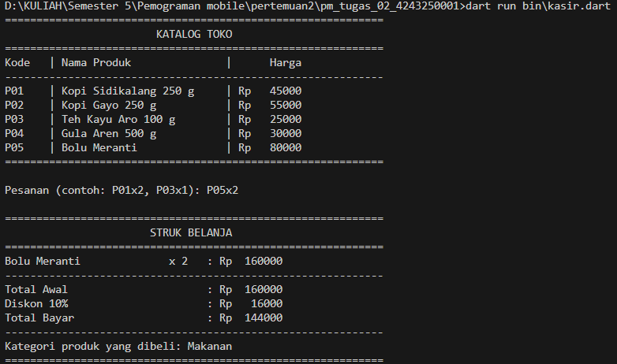
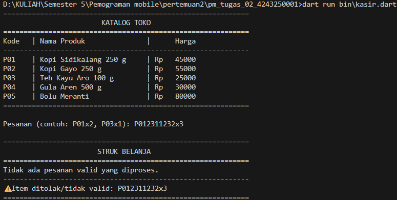

# Tugas Rutin 2: Aplikasi Console Kasir Sederhana

## (a) Identitas
* **Nama:** Yohanes Gerardus Haga Zai
* **NIM:** 4243250001
* **Kelas:** PSIK 24C
* **Mata Kuliah:** Pemrograman Mobile

---

## (b) Tangkapan Layar Skenario Pengujian

### 1. Skenario Pesanan Valid
Pada skenario ini, semua input kode produk tersedia di katalog dan jumlah yang dimasukkan berupa angka valid. Total belanjaan mencapai batas minimal diskon sehingga potongan harga 10% berhasil diterapkan.



### 2. Skenario Pesanan Mengandung Kode Salah / Tidak Valid
Pada skenario ini, input sengaja dimasukkan dengan format salah (misalnya tidak ada huruf 'x'), menggunakan kode produk yang tidak terdaftar di katalog, atau memasukkan jumlah yang bukan angka. Program berhasil mendeteksi dan memasukkannya ke daftar item ditolak tanpa membuat aplikasi *crash*.



---

## (c) Penjelasan Konsep Dart & Penanganan Null Safety

### Perbedaan var, final, dan const
Dalam bahasa Dart, `var` digunakan untuk mendeklarasikan variabel yang tipe datanya dideteksi secara otomatis (*type inference*) dan nilainya masih dapat diubah kapan saja selama program berjalan. Sebaliknya, `final` dan `const` digunakan untuk nilai yang bersifat tetap (imutabel) setelah diisi. Perbedaannya terletak pada waktu inisialisasi: `final` ditentukan saat program sedang berjalan (*runtime*), contohnya saat membaca input pengguna (`final String input = stdin.readLineSync() ?? '';`). Sementara itu, `const` harus sudah diketahui nilainya sejak kode dikompilasi (*compile-time*), bersifat konstanta murni, dan tidak bisa menerima nilai dari proses dinamis *runtime*.

### Bagaimana Null Safety Mencegah Crash pada Program
Fitur *Null Safety* pada Dart memastikan bahwa suatu variabel secara bawaan tidak boleh bernilai `null` (*non-nullable*), kecuali jika secara eksplisit ditandai sebagai *nullable* menggunakan tanda tanya (`?`). Hal ini mencegah terjadinya eror fatal *Null Pointer Exception* saat program berjalan. 

Pada kode program kasir ini, *Null Safety* diterapkan untuk mencegah *crash* pada dua bagian krusial:
1. **Pencarian Produk di Katalog:** Pada baris kode `final produk = katalog[kode];`, variabel `produk` secara otomatis bertipe *nullable* karena produk yang dicari bisa saja tidak ada di dalam `Map`. Program mengantisipasinya dengan validasi ketat pada baris `if (... || produk == null)`. Jika bernilai `null`, item langsung ditolak dan program melanjutkan proses ke baris berikutnya menggunakan perintah `continue`, alih-alih mencoba mengakses properti objek kosong yang dapat memicu eror.
2. **Konversi Angka Jumlah Pesanan:** Baris kode `final int? jumlah = int.tryParse(jmlStr);` menggunakan tipe data `int?` (*nullable*). Jika pengguna salah mengetik jumlah (misalnya huruf atau simbol), fungsi `tryParse` tidak akan membuat aplikasi berhenti, melainkan mengembalikan nilai `null`. Nilai ini kemudian disaring dengan aman pada baris pengecekan `if (jumlah == null || jumlah <= 0 || ...)`, sehingga eksekusi kalkulasi aritmatika matematika di bawahnya terjamin bebas dari nilai *null*.

## 3. Hasil dart analyze tanpa error
Kode program telah diperiksa menggunakan alat analisis statis bawaan Dart SDK (`dart analyze`).
Aplikasi kasir ini memberikan hasil bersih:

```
Analyzing pm_tugas_02_4243250001...
No issues found!
```